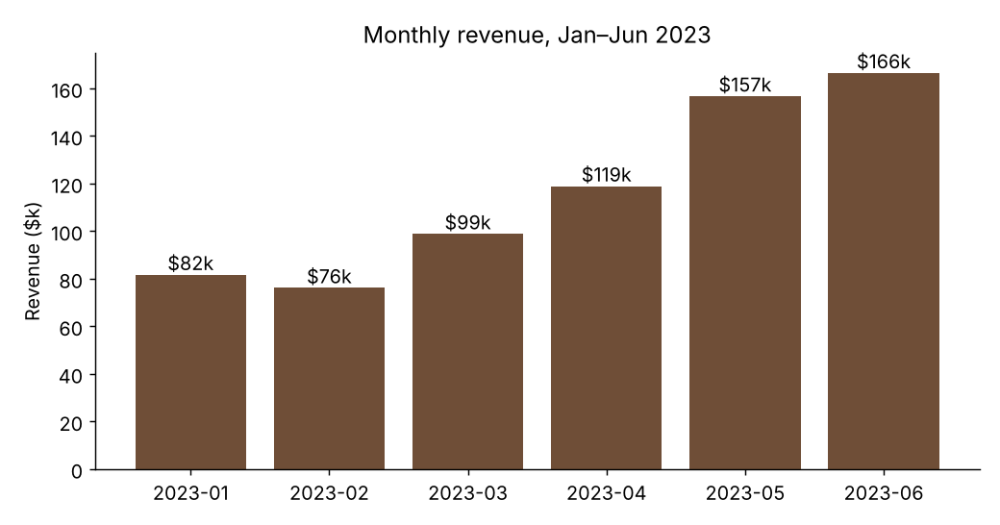
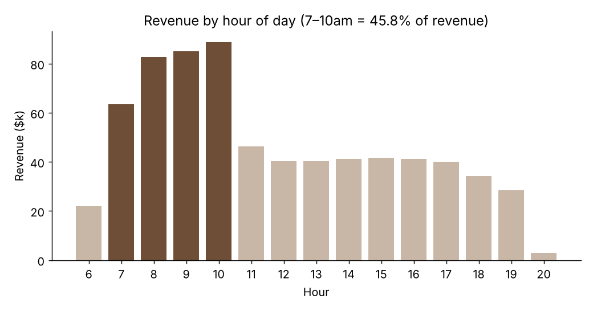
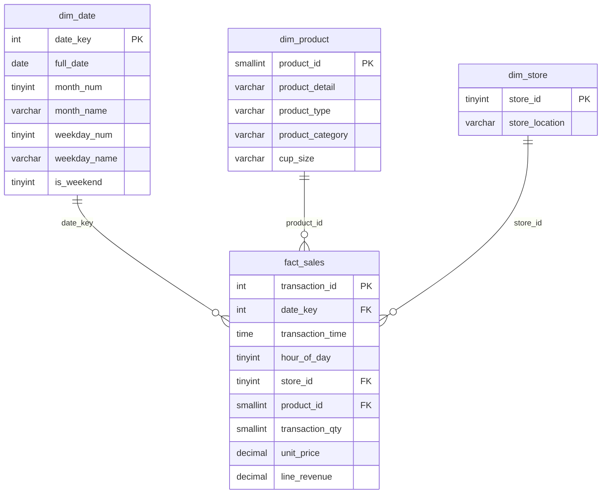
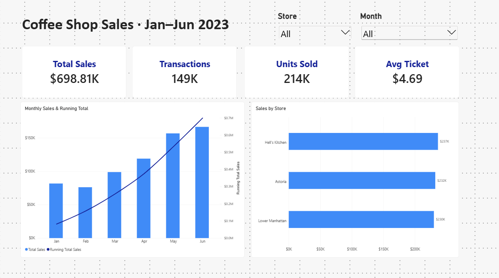
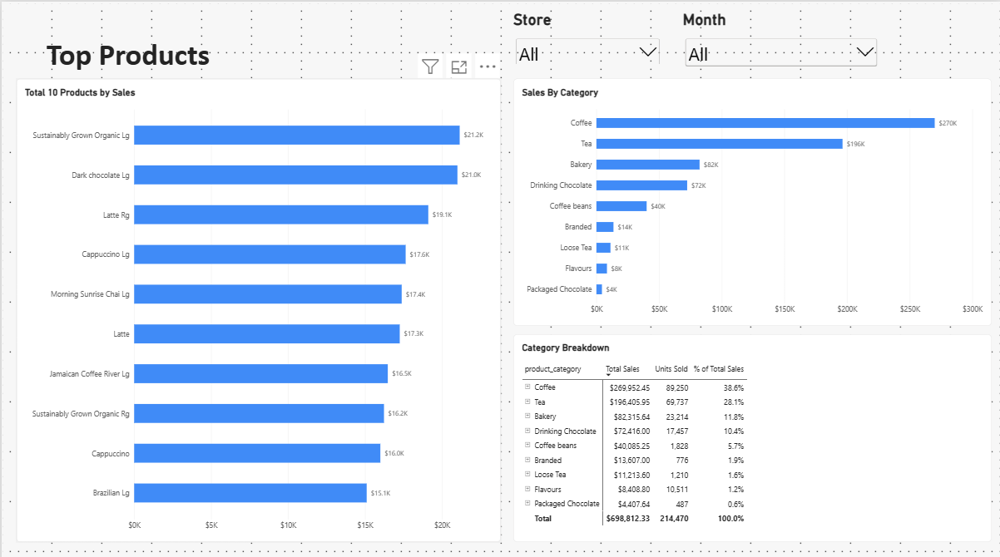
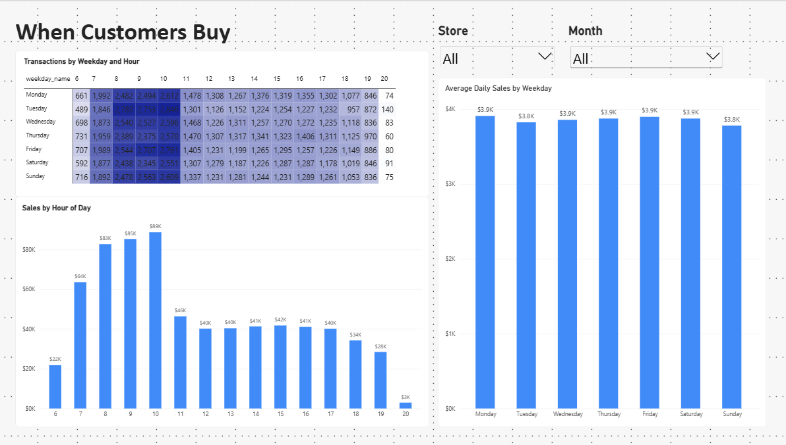
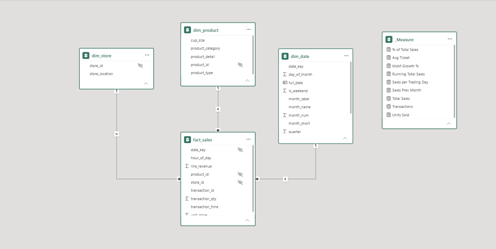

# ☕ Coffee Shop Sales Analysis: MySQL + Power BI

End-to-end analysis of **149,116 transactions** from a 3-outlet coffee chain (Jan–Jun 2023, **$698,812 revenue**). I loaded and cleaned raw Excel data in MySQL, answered business questions with SQL (CTEs and window functions), modelled a star schema, and built an interactive Power BI report with DAX.

**Headline:** revenue doubled in six months (+103.8%) entirely through more transactions. Average ticket stayed flat at about $4.69, which makes ticket size the biggest untapped growth lever. → [Full insights & recommendations](INSIGHTS.md)




---

## Tools
MySQL 8 · SQL (CTEs, window functions, recursive CTE) · Power BI (Power Query, data modelling, DAX) · Git/GitHub

## Workflow

| Step | What | File |
|---|---|---|
| 1 | Load raw CSV into a text-only staging table | [`sql/01_load.sql`](sql/01_load.sql) |
| 2 | Profile, type-cast and clean the data, then reconcile totals | [`sql/02_clean.sql`](sql/02_clean.sql) |
| 3 | Answer 12 business questions | [`sql/03_analysis.sql`](sql/03_analysis.sql) |
| 4 | Build the star schema | [`sql/04_star_schema.sql`](sql/04_star_schema.sql) |
| 5 | Power BI model, DAX and report | [`powerbi/`](powerbi/POWER_BI_GUIDE.md) |
| 6 | Insights & recommendations | [`INSIGHTS.md`](INSIGHTS.md) |

## Data cleaning: what I found
| Check | Result | Action |
|---|---|---|
| Nulls / blanks | 0 in all 11 columns | none needed |
| Duplicate transaction IDs | 0 | none needed (IDs have 340 gaps, which is normal) |
| Trailing whitespace | `'Scottish Cream Scone '` on 1,952 rows | `TRIM()`. I detected it with `CHAR_LENGTH`, because MySQL's PAD SPACE collation makes `'abc ' = 'abc'` return true |
| Same product, several prices | 15 products (mostly bakery & merchandise) | kept price on the **fact** row, not the product dimension |
| Store ID ↔ location | 1:1 for all 3 stores | built `dim_store` |
| Text types | everything loaded as text | cast to `DATE`, `TIME`, `DECIMAL`, `INT`; added computed `line_revenue` |

Reconciliation: 149,116 rows and $698,812.33 match in the raw file, the clean table and the star schema.

## Star schema



Grain: one row per transaction line. `dim_date` is generated with a recursive CTE so every calendar day exists, which Power BI time intelligence needs.

## SQL techniques shown
- **CTEs** to break each question into readable steps
- **`LAG()`** for month-over-month growth
- **`RANK()` / `ROW_NUMBER()`** for top-10 products and the best seller per category
- **`SUM() OVER ()`** for share of total, running totals (YTD and MTD), and a Pareto (80/20) analysis
- **`AVG() OVER (ROWS BETWEEN 6 PRECEDING AND CURRENT ROW)`** for a 7-day moving average
- **`WITH RECURSIVE`** to generate the date dimension

## Power BI
- Power Query: typed imports of the star-schema tables
- Model: three 1-to-many relationships, marked date table, sort-by-column for months and weekdays
- DAX: `Total Sales`, `Transactions`, `Avg Ticket`, `Sales Prev Month`, `MoM Growth %`, `Running Total Sales`, `Sales YTD`, `Sales per Trading Day`, `% of Total Sales`
- Pages: Overview · Products · Time (weekday × hour heatmap)
- Every measure reconciled against the SQL results (total $698,812.33; monthly totals, MoM % and running total match)

### Report pages
**Overview:** KPI cards, monthly sales with running total, sales by store, synced Store/Month slicers


**Products:** top 10 products (Top N filter), sales by category, category → type → product matrix


**Time:** weekday × hour heatmap, sales by hour, average daily sales by weekday


**Data model**


## How to reproduce
1. Install MySQL 8 + MySQL Workbench.
2. Run `sql/01_load.sql` (update the CSV path first; see the notes at the top of the file), then `02`, `03`, `04` in order.
3. Open `powerbi/Coffee_Shop_Sales.pbix`, or rebuild it with [`powerbi/POWER_BI_GUIDE.md`](powerbi/POWER_BI_GUIDE.md).

## Dataset
Coffee Shop Sales sample dataset (fictional coffee chain, 3 New York outlets). Source: Coffee Shop Sales sample dataset (fictional coffee chain, 3 New York outlets). Source: [Kaggle – Coffee Shop Sales (ahmed abbas)](https://www.kaggle.com/code/ahmedabbas757/coffee-shop-sales)

## Repository structure
```
├── data/coffee_shop_sales_raw.csv     raw data exported from the Excel file
├── sql/01_load.sql … 04_star_schema.sql
├── results/analysis_output_full.txt   output of every analysis query
├── powerbi/
│   ├── POWER_BI_GUIDE.md              Power Query, relationships, DAX, layout
│   ├── data/                          star-schema tables as CSV
│   └── Coffee_Shop_Sales.pbix         the report
├── images/                            charts & report screenshots
└── INSIGHTS.md                        findings & recommendations
```
